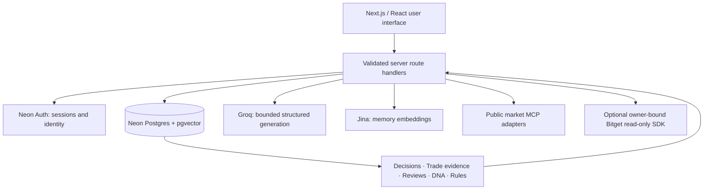

<div align="center">

<a href="https://tryreflex.vercel.app" aria-label="Visit Reflex">
  
</a>

# Reflex

### Your trading decisions have a memory.

**Capture the decision. Examine the evidence. Learn from the process. Recall the lesson.**

Reflex is an evidence-backed trading decision desk that helps you understand **how you made a trade**, not just whether it made money.

[](https://tryreflex.vercel.app)
[](https://github.com/Devendurance/tryreflex)
[](https://github.com/Devendurance/tryreflex/issues)

[](https://github.com/Devendurance/tryreflex/stargazers)
[](LICENSE)
[](https://nextjs.org/)
[](https://www.typescriptlang.org/)

[**Open Reflex**](https://tryreflex.vercel.app) · [**How it works**](#how-reflex-works) · [**Demo walkthrough**](#demo-walkthrough) · [**Run locally**](#local-development) · [**Architecture**](#architecture)

</div>

<!-- HERO / PRODUCT PREVIEW SLOT
     Add an approved public-facing product screenshot at docs/media/reflex-hero.png.
     Then uncomment the following markup:
     <p align="center"></p>
     Do NOT use a screenshot containing private email addresses, API keys, account IDs or financial data without consent.
-->

---

## Why Reflex exists

**P&L is a bad teacher.** A profitable trade can come from a poorly supported decision, and a losing trade can still have followed a sound process. Most trading journals record entries, exits and outcomes, but lose the original thinking that led to the trade.

Reflex preserves the decision as it was understood at the time, links it to genuine trade evidence, reviews the process, and surfaces relevant lessons before a future decision. It deliberately separates **decision quality** from **financial outcome**.

> **The loop:** Decide → Trade → Understand → Learn → Evolve → Recall → Decide better.

## Hackathon context

Built for **Bitget AI Base Camp Season 2, Track 3: AI Trading Desk — Review & Self-Evolution**. Reflex demonstrates a decision-review and learning workflow with genuine, owner-controlled evidence. The MVP does not place trades or claim predictive financial performance.

## How Reflex works

| Stage | Product area | What it does |
| --- | --- | --- |
| **Decide** | Decision Desk | Write your rationale in natural language, inspect structured suggestions, correct them and confirm your original decision. |
| **Trade** | Trade Activity & Evidence | Record known execution facts manually or import Bitget Classic Spot CSV history. Preserve missing values as unknown. |
| **Understand** | Autopsy | Review process across research, context, risk, execution and behavioral discipline with evidence-backed findings and explicit coverage. |
| **Learn** | Decision DNA | Turn accepted reviews into observations. Stronger recurring findings require independent qualifying history. |
| **Evolve** | Playbook | Propose grounded process rules as **Experimental**. Rules require a user's explicit decision before activation. |
| **Recall** | Pre-Trade Recall | Retrieve semantically relevant owned history and ask evidence-backed questions before a prospective trade. No order is placed. |

### The decisions stay yours

- **Confirmed vs. inferred:** The application distinguishes user-confirmed origins and facts from AI suggestions.
- **Original snapshot preserved:** Later outcomes do not rewrite the original rationale.
- **Unknown means unknown:** Unverified market context, missing execution data and unknown realized P&L are never silently filled in.
- **One review is not a habit:** Single-decision findings remain observations, without invented recurrence or effectiveness.
- **User approval matters:** Pending Playbook proposals are inactive. Reflex does not automatically trade or block trades.
- **Source traceability:** Reviews, observations and proposed rules link to the evidence that supports them.

## Screenshots and demo assets

> **Asset placeholders:** These are suggested file paths, not images currently included in the repository. Replace with approved captures before submission; avoid accidentally publishing personal account or financial information.

| Material | Placeholder path | Suggested content |
| --- | --- | --- |
| Hero / cover | `docs/media/reflex-hero.png` | Full-width landing or product preview |
| Decision Desk | `docs/media/decision-desk.png` | Draft, structured extraction and confirmation |
| Autopsy | `docs/media/autopsy.png` | Grounded scoring and evidence coverage |
| Decision DNA | `docs/media/decision-dna.png` | Observation maturity and supporting review |
| Playbook | `docs/media/playbook.png` | Experimental proposals pending user action |
| Pre-Trade Recall | `docs/media/pre-trade-recall.png` | Relevant history, watchpoints and questions |
| Demo video | `docs/media/demo-link.txt` | Add the public video URL when available |
| Architecture diagram | `docs/media/architecture.png` | Optional exported version of the diagram below |

<!-- Once screenshots exist, add a gallery here, e.g.:
<p align="center"></p>
-->

## Demo walkthrough

A meaningful walkthrough follows the same history through the product:

1. **Capture:** Describe a real trade decision and confirm the original context, with any AI origin suggestions clearly labeled.
2. **Attach evidence:** Add authentic trade observations or classify genuine Bitget Classic exchange activity. Do not equate payment conversions with speculative trades.
3. **Review:** Open the Autopsy and inspect process scores, evidence coverage, unknowns and any supported plan drift.
4. **Learn:** Inspect Decision DNA. One supporting decision produces observations, not an asserted recurring pattern.
5. **Evolve:** Review pending Experimental Playbook proposals and the exact evidence behind them. No rule is accepted by default.
6. **Recall:** Enter a prospective trade idea and retrieve relevant historical watchpoints and questions without saving a new decision or placing an order.

**Live demo:** [tryreflex.vercel.app](https://tryreflex.vercel.app)

**Recorded demo:** _Placeholder: insert the public video URL here after it is produced and approved._

## Bitget integration: implemented vs. future

Reflex has **three distinct integration paths**. They should not be confused:

| Integration | Implementation | User-facing status |
| --- | --- | --- |
| **Bitget Classic Spot CSV** | Preview real order/fill history, classify purpose, confirm import, retain import receipts and audit changes | Available in Trade Activity |
| **Manual trade evidence** | Attach genuine known execution/cash-flow observations, including incomplete or retrospective accounts | Available in the decision workflow |
| **Bitget authenticated Futures SDK** | Server-side, read-only import of selected closed USDT/USDC Futures position history with bounded queries and strict owner binding | Backend exists; **no self-service “Connect Bitget” UI** |
| **Per-user Bitget account linking** | User-authorized API-key/OAuth onboarding and per-user synchronization | **Not implemented** |

The private SDK path is restricted to an explicitly configured authenticated subject. It is **not** multi-user Bitget account syncing. Never put private exchange credentials in the client or treat an optional server-side binding as a user-facing connection feature. Exchange data also cannot, by itself, establish a trader's original motive.

### Public market-context research

The backend exposes a bounded market-context service (`POST /api/market/context`) with allowlisted public MCP providers:

- **Bitget Agent MCP:** US-equity price quotes and historical market data, using the documented tool catalog.
- **Bitget Signal integration:** Crypto sentiment via its separate public data-provider MCP service.

These are **public market-context inputs**, separate from authenticated Bitget account data. They do **not** require `BITGET_API_KEY`, `BITGET_SECRET_KEY` or `BITGET_PASSPHRASE`. Provider results are normalized and carry provenance; unavailable data remains unavailable.

The market-context API should **not** be mistaken for a full autonomous research agent or a guarantee that every Autopsy automatically receives live prices. Crypto sentiment is not a token-level live quote feed.

## Architecture



### Technology

| Layer | Technology |
| --- | --- |
| Frontend | Next.js 16 App Router, React 19, TypeScript, Tailwind CSS 4 |
| Identity | Neon Auth using server-managed sessions |
| Database | Neon PostgreSQL, Drizzle ORM, pgvector for retrieval |
| Structured AI | Groq, using validated JSON and evidence reference checks |
| Retrieval | Jina passage/query embeddings, owner-scoped semantic retrieval |
| Exchange evidence | Bitget Classic Spot CSV parser; optional Bitget Agent SDK read-only Futures integration |
| Market context | Public Bitget Agent MCP and Bitget Signal MCP adapters |
| Hosting | Vercel |

### Core application routes

| Route | Purpose |
| --- | --- |
| `/` | Landing page |
| `/sign-in`, `/sign-up` | Authentication |
| `/app` | Authenticated overview |
| `/app/decisions` | Decision Desk |
| `/app/activity` | Exchange activity and Classic CSV imports |
| `/app/autopsies` | Autopsy history |
| `/app/dna` | Decision DNA |
| `/app/playbook` | Proposals and user-controlled rules |
| `/app/recall` | Pre-Trade Recall |

## Local development

### Requirements

- Node.js compatible with Next.js 16 (the Vercel project currently uses Node.js 24.x)
- npm
- A Neon Postgres database with Neon Auth configured
- Groq and Jina API credentials for live AI features

```bash
git clone https://github.com/Devendurance/tryreflex.git
cd tryreflex
npm ci
cp .env.example .env.local
npm run dev
```

On Windows PowerShell, copy the example environment file using `Copy-Item .env.example .env.local`.

Visit `http://localhost:3000`. To use an alternative port, run `npm run dev -- -p 3002`.

### Environment variables

Provide secret values locally in `.env.local` or through your hosting provider's secure environment settings. **Never commit credentials.**

| Variable | Required? | Purpose |
| --- | --- | --- |
| `DATABASE_URL` | Yes | Pooled Neon Postgres connection |
| `DATABASE_URL_UNPOOLED` | Yes for migration tooling | Direct connection to the same intended database |
| `NEON_AUTH_BASE_URL` | Yes | Existing Neon Auth service URL |
| `NEON_AUTH_COOKIE_SECRET` | Yes | Server-side cookie signing, 32+ characters |
| `GROQ_API_KEY` | Yes for AI features | Structured generation |
| `GROQ_MODEL` | Yes for AI features | Configured Groq model |
| `JINA_API_KEY` | Yes for semantic memory | Embedding provider |
| `JINA_EMBEDDING_MODEL` | Yes for semantic memory | Locked embedding model |
| `JINA_EMBEDDING_DIMENSIONS` | Yes for semantic memory | Matching stored vector dimensionality |
| `BITGET_API_KEY`, `BITGET_SECRET_KEY`, `BITGET_PASSPHRASE` | Optional | Private Bitget SDK, **not public market MCP** |
| `BITGET_ACCOUNT_AUTH_SUBJECT` | Optional; mandatory for private SDK import | Restrict private credentials to one trusted authenticated subject |
| `AGENTKEY_API_KEY` | Optional | Integration/diagnostic features |
| `MCP_TIMEOUT_MS` | Optional | Public MCP request timeout |

Only configure private exchange credentials when that owner-bound integration is intentionally enabled. Production and preview credential scopes should be reviewed separately.

### Database migrations

Existing, populated databases must **not** be reset, reseeded or blindly remigrated. Review the versioned SQL files in `drizzle/` and the current migration journal before changing a live database.

For a **fresh database you own**, after reviewing the migration plan:

```bash
npm run db:migrate
```

The project contains four versioned migrations. `npm run db:generate` creates a new migration from schema changes; it is not a required step on every startup. `npm run db:verify` is an integration check requiring live database connectivity.

## Testing and verification

```bash
npm run test:all
npm run type-check
npm run lint
npm run build
```

Focused test suites include market adapters, persistence, AI, decisions, Autopsy, DNA, Recall, Playbook and Classic CSV. At the October 2026 release QA checkpoint, **476 automated tests passed** locally, with two pre-existing nonblocking lint warnings. This is a historical test result, **not** a claim that a GitHub Actions workflow is continuously passing.

Additional real-provider verification scripts exist, but may require real credentials and authenticated fixtures. Review their requirements before running them; they are not prerequisites to reading the README or browsing the public application.

## Security, privacy and evidence integrity

- Protected workspace pages require authentication; server handlers verify the caller's identity.
- Decisions, trade evidence, reviews, patterns, rules and retrieval are scoped to the authenticated owner.
- Historical facts and AI inferences are separately labeled; ungrounded claims are rejected rather than silently accepted.
- Missing quotes, uncertain context and unknown trade economics remain explicit.
- CSV imports use a preview-and-confirm flow; the file is not sent to a generative AI provider.
- Private API keys belong on the server only. Client-side exchange account connection and delegated access are **not** implemented.
- AI run bookkeeping tracks bounded operational metadata, not hidden reasoning or raw provider responses.
- A verified process review is not evidence of profit, trading edge or future performance.

**Do not upload private trades or use another person's exchange credentials without their permission.** If preparing a public demo, redact personal information or obtain consent for the exact material shown.

## Current limitations

- No self-service Bitget account connection, account sync or trading execution.
- Private Bitget read-only Futures import is an owner-bound backend integration, not a multi-tenant public connection.
- Public market context is a bounded backend service, not comprehensive investment research or guaranteed live enrichment of all reviews.
- Autopsy generation can fail closed when the model cannot ground its findings; retry is not guaranteed to succeed.
- Accepted-rule Recall and two-live-account isolation have automated coverage but were not live-verified in the release acceptance walkthrough.
- The app does not establish realized returns from token market-cap movements alone, and the review score is a product-defined process metric rather than investment advice.

## Contributing and feedback

Bug reports, documentation corrections and focused improvement suggestions are welcome through [GitHub Issues](https://github.com/Devendurance/tryreflex/issues). Please do not paste secrets, session cookies, private account identifiers or raw financial exports into public issues.

For changes, create a focused branch, run the relevant tests and describe the user-visible effect and verification in your pull request.

## License

Released under the **[MIT License](LICENSE)**. Copyright (c) 2026 Devendurance. Third-party libraries, external data providers, trademarks and service terms retain their own licenses and restrictions.

---

<div align="center">

**Reflex — decisions worth learning from.**

[Open the app](https://tryreflex.vercel.app) · [View source](https://github.com/Devendurance/tryreflex) · [Report an issue](https://github.com/Devendurance/tryreflex/issues)

</div>
